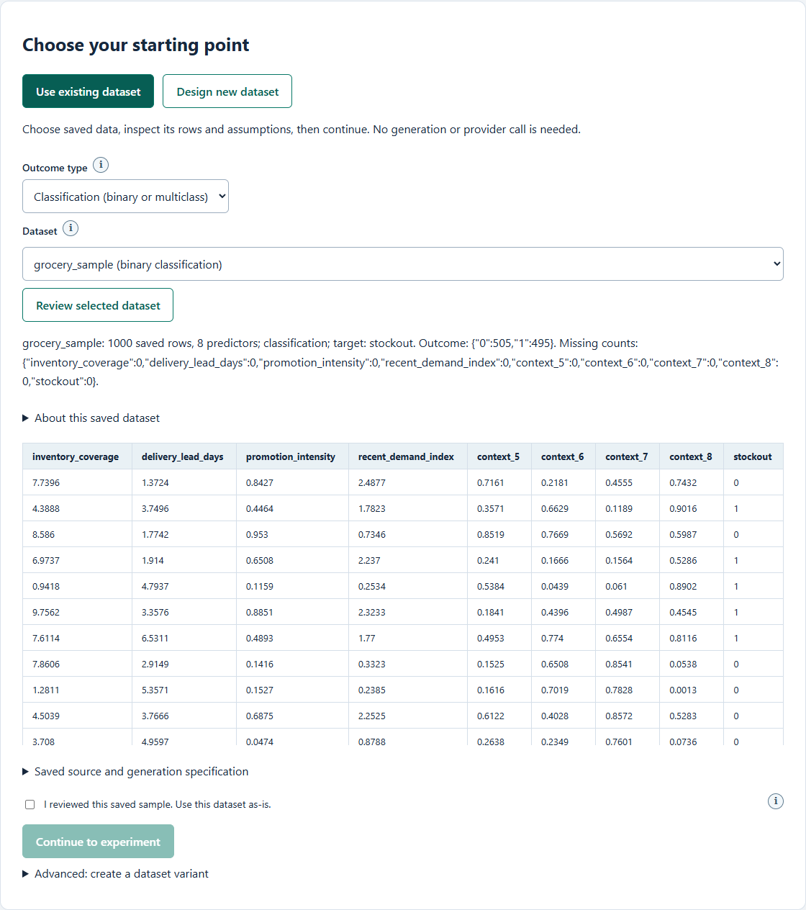
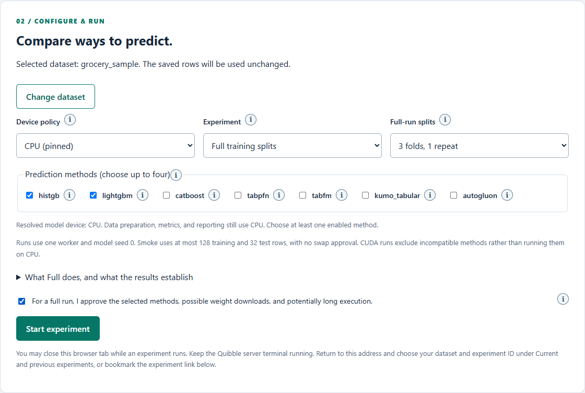
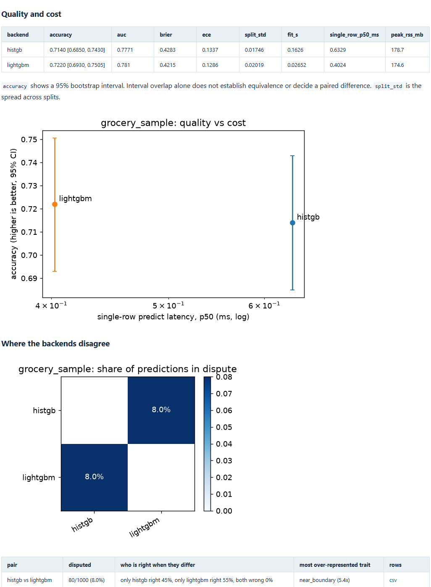

# Quibble

[](requirements.txt)
[](LICENSE)
[](docs/testing-your-data.md)
[](docs/gpu-and-docker.md)
[](docs/index.md#trust-levels-what-has-actually-been-run)

**Compare ways to predict from your data. See which answers change, and at what cost.**

Suppose you have historical invoices and know which were paid late. You want to predict
late payment for new invoices, using only information available before the outcome.
Which prediction method should you use, and what changes if you choose another?

Quibble compares methods on the same held-out examples, checks their answers against known
outcomes, and reports disagreements, prediction quality, and measured execution costs.
It supports predicting categories (classification) and numbers (regression) from tables.

Today, the methods include tree-based learning, AutoML, and pretrained tabular predictors.
The latter are also called *tabular foundation models*: they bring learning from other
tables to a new prediction task.

**Could ChatGPT do this too?** It can analyze CSVs, attempt predictions, or use tools to
run statistical methods. The distinction is not the file format: it is whether the
predictions are tested on held-out outcomes under defined rules. Quibble does not yet
include a chat-LLM comparison; see the [scope and proposed evaluation](<docs/quibble why, what, and what it isn't.md#could-chatgpt-predict-from-the-same-csv>).

[Quick start](#quick-start) | [Web workbench](docs/experiment-workbench.md) | [Your data](#test-your-own-data) | [Models and workflows](#recommended-comparison-workflows) | [Reports](#results-reuse-and-history) | [Documentation](#documentation)

## See the workflow

Choose data, compare prediction methods, then inspect the evidence behind the scores.
These screenshots use the bundled fictional `grocery_sample` dataset. No provider
request or private data is involved.

### 1. Choose and review data

Use ready-made rows or design a synthetic dataset. Review its assumptions and sample
before continuing.



### 2. Configure a comparison

Choose methods, CPU/CUDA policy, and evaluation splits. Here, HistGB and LightGBM use
the same saved data with CPU execution and three-fold evaluation.



### 3. Read the result, not just the ranking

Inspect quality, uncertainty, costs, disagreements, and failures in the generated report.
This is a real local full comparison, not a mockup or a claim about real grocery operations.
Results depend on the dataset, settings, and hardware.



The [workbench guide](docs/experiment-workbench.md) explains the complete interactive
flow; the [report guide](docs/reports.md) explains the evidence and its limits.

## Why quibble?

| Look beyond the score | What you get |
|---|---|
| Quality and uncertainty | Confidence intervals, calibration, and weak slices |
| Prediction-level differences | Disputed rows, who was right, and shared row traits |
| Real execution costs | Fit time, prediction latency, memory, errors, and refusals |
| Replacement decisions | PASS / FAIL / INCONCLUSIVE checks with configurable limits and CI exit codes |
| Reproducible evidence | Saved predictions, source fingerprints for local data, dated reports, and explicit device labels |

It is a comparison and verification tool, not a tuner, model server, or deployment platform.
See the [project rationale](<docs/quibble why, what, and what it isn't.md>) for the scope and motivation.

## Quick start

### Set up this repository's local environment

Use Python 3.13 for this Windows setup; the full requirements need Python 3.11+.
Run from Quibble's root. If another virtual environment is active, run `deactivate` first.

```powershell
# Requires uv. Reuse an existing local .venv rather than creating another environment.
if (-not (Test-Path .\.venv\Scripts\python.exe)) {
    uv venv --python 3.13 --seed .venv
}
& .\.venv\Scripts\Activate.ps1
python -c "import sys; print(sys.executable)"
python -m pip install -r requirements.txt
python -m pip install --no-deps -e .
python -m pip check
python -m quibble doctor
```

<details>
<summary>Environment requirements, CUDA wheels, and maintenance</summary>

- The interpreter must end in `quibble\.venv\Scripts\python.exe`.
- Use only this local `.venv` and `requirements.txt`. Requirements include model libraries,
  report/notebook dependencies, and pytest; the editable install registers local Quibble
  without choosing another dependency set.
- In later shells, activate the same `.venv`. After requirements change, repeat both install
  commands and `pip check`. Never update packages while a sweep is running.
- Installation needs network access and substantial disk space for PyTorch and AutoGluon,
  plus later model downloads. Pass your trusted `--index-url` if a package mirror is required.
- Windows requirements select `torch==2.11.0+cu128` and `torchvision==0.26.0+cu128` from the
  official CUDA 12.8 wheel index, replacing CPU-only builds. GPU use needs a compatible NVIDIA
  driver, not a separate CUDA Toolkit installation.
- Windows/Python 3.13 dependency resolution and local CUDA detection have been checked.
  Detection is not proof that every model, task, or dataset works; see [validation status](docs/index.md#trust-levels-what-has-actually-been-run).

</details>

### Use the browser workbench

```powershell
python -m quibble web --open
```

Design a synthetic prediction task, review its assumptions and sample rows, save the
dataset, and run smoke/full comparisons at `http://127.0.0.1:8765`. Four ready-made
datasets are available. The default address opens About; choose **Open workbench**
to enter the experiment workflow at `/workbench`. The four bundled
datasets cover grocery and retail clothing, each with binary and regression targets.
Select one to reuse its saved rows without a cloud connection or regeneration.
Start with **Use existing dataset** or **Design new dataset**, then follow
**Choose data -> Configure & run -> Results**. The run screen uses the chosen dataset;
**Past experiments** opens saved reports independently.
The single existing-data selector filters classification (binary or multiclass) and
regression, grouping built-in, bundled, and saved tables without implying different
readiness levels. New synthetic designs support binary classification or regression.
After preview and review, **Save and continue** saves and opens configuration.
For a variant, the adjacent **Discard changes and continue** uses the unchanged
original instead. Neither starts a run automatically. Preview generation is disabled
for an unchanged saved recipe or a completed preview until the recipe changes.

The product header makes **Quibble** prominent with a smaller explanatory subtitle.
All pages share **Workbench / Blog / About / GitHub / Docs** navigation.
Blog, About, and Docs open separately from the workbench to preserve drafts.
Blog and Docs are readable locally; GitHub links to the source repository.
Version and license details belong in About's project-status section, not the header.
Arbitrary scenario drafting uses a user-configured
OpenAI-compatible provider, including OpenAI, Azure, or a compatible local service,
with explicit consent and API-key, Microsoft Entra ID, or local no-auth configuration.
See the [workbench guide](docs/experiment-workbench.md) for setup, limits, and provenance.
Synthetic results describe the chosen simulation, not real-world business performance.

Why generate fresh data? Public benchmarks may have appeared in a pretrained predictor's
training data. New sampled rows reduce reuse of those benchmark examples and let you
control noise, missingness, and irrelevant inputs. They do not prove the underlying task
is unseen or eliminate pretraining-exposure concerns. Repeat across generation seeds
and check findings on representative real data.

The browser is an additional interface to the existing evaluation workflow, not a
replacement for CLI commands. Use it for interactive review; keep the commands below
for automation and more extensive configurations.

### Try the demo

```powershell
python -m quibble demo
```

Open `results/report/report.md` for the interpreted comparison, or use the report under
your configured output root.

> [!NOTE]
> The default demo is CPU-only and works offline after installation. Use `benchmark`
> for device-aware CPU/GPU comparisons.

<details>
<summary>What the demo runs, expected sanity checks, and optional foundation models</summary>

- Runs a sweep, analysis, swap checks, and report on built-in `breast_cancer`, `wine`,
  and `diabetes_reg`; typically about a minute for the default models.
- Uses `histgb`, `lightgbm`, and deliberately weak `weak`, with model seed 0 and CV `3x2`.
  The HistGB-to-Weak sanity check is expected to FAIL.
- Always forces CPU, overriding `.env`, even with foundation models selected. It has no
  `--device` option. Installing model packages does not automatically select them.
- Default models need no pretrained downloads and work offline after installation.
- Open `results/report/report.md`, or the report under your configured output root.

To include foundation models in the CPU demo:

```powershell
python -m quibble demo --backends histgb,lightgbm,tabfm,kumo_tabular --jobs 1
```

This still uses all three demo datasets, but may download weights and run much longer.
Swaps use HistGB as incumbent when selected, otherwise the first selected backend.
For GPU measurements, use `benchmark` or `run` instead.

</details>

## Test your own data

Create a named folder with a labeled table and a small declaration:

```text
data/
  payments/
    data.csv          Or data.parquet
    dataset.json      Target, task, and optional column rules
```

```powershell
python -m quibble datasets --verify --names payments
python -m quibble benchmark --datasets payments --backends histgb,lightgbm --device cpu --jobs 1 --smoke
```

Follow **[Testing your own data](docs/testing-your-data.md)** for the manifest, accepted formats,
a runnable sample, full comparisons, output locations, interpretation, reruns, and privacy.
Inputs stay separate from download caches; changed local data cannot silently reuse old comparisons.

## Recommended comparison workflows

`benchmark` honors `QUIBBLE_DEVICE` or an explicit `--device cpu|cuda|auto`.
It defaults to `wine`, CV `3x2`, and model seed 0.

| Preset | Backends |
|---|---|
| `trees` | HistGB, LightGBM, CatBoost |
| `foundations` (default) | HistGB, LightGBM, Google TabFM, NVIDIA KumoTabular |
| `all` | Every non-internal backend, including TabPFN and AutoGluon |

```powershell
# Bounded setup check; may download weights.
python -m quibble benchmark --preset foundations --smoke

# Full comparison; archive and replace selected cached measurements.
python -m quibble benchmark --preset foundations --force
```

<details>
<summary>Custom selections, saved models, participation, and exit codes</summary>

```powershell
# Optional fitted models and AutoGluon's validation leaderboard.
# Use a separate root when changing from the CV scheme above to holdout.
python -m quibble benchmark --backends histgb,autogluon --cv holdout --keep-models --out results_holdout
```

- `--backends` overrides the preset. Other controls include `--datasets`, `--cv`,
  `--model-seeds`, `--jobs`, `--threads`, and `--out`. Use `--jobs 1` for measured comparisons.
- The participation table distinguishes selected, cached, incompatible, failed, refused,
  and missing cells, and shows fits used in the comparison. Preset comparisons exclude
  incompatible cached backends until rerun.
- Exit codes: 0 when requested fits completed; 1 for failed/refused/missing/incompatible
  cells; 2 for configuration/usage errors. A swap verdict of FAIL is not a fit failure.

</details>

### Smoke checks

> [!IMPORTANT]
> Smoke reports interpret bounded setup results, not full-data model quality.
> They do not issue deployment recommendations or swap approval.

<details>
<summary>Sampling limits, output isolation, and download requirements</summary>

- One holdout split, model seed 0, at most 128 training and 32 test rows.
- Identical sampled rows across backends; writes to `results/smoke/<unique-id>/`.
- Reports say `SMOKE TEST ONLY` and interpret setup outcomes, scores, resources, and
  disagreements, without deployment recommendations or swap verdicts.
- Checks setup, not full-data quality or capacity. Weight downloads can still be large
  or require authentication.

</details>

### GPU comparison

| Policy | Behavior |
|---|---|
| `cpu` | Pins every model to CPU |
| `cuda` | Requires CUDA; runs only compatible models and visibly excludes the others |
| `auto` (default) | Resolves once per sweep to CUDA if available, otherwise CPU |

CatBoost, TabPFN, TabFM, and KumoTabular support CUDA. When the resolved device is CUDA,
HistGB, LightGBM, Weak, and AutoGluon are excluded with reasons rather than run on CPU.
HistGB/Weak have no CUDA implementation; this LightGBM adapter uses CPU, and AutoGluon
cannot guarantee GPU-only components. An all-excluded selection is rejected.
CPU comparisons retain all selected methods. CUDA methods run serially; CPU comparisons
can use `--jobs`. Data preparation, metrics, and reports still use CPU.

See [what Full does and what the results establish](docs/running-benchmarks.md#what-full-does-and-what-the-results-establish)
for the split, fit, held-out prediction, and analysis sequence.

<details>
<summary>Explicit CUDA example, resource failures, and mixed-device reporting</summary>

```powershell
python -m quibble doctor
python -m quibble benchmark --backends catboost,tabfm,kumo_tabular --datasets wine --cv 3x2 --model-seeds 0 --device cuda --jobs 1 --out results_cuda --force
```

- Let a current sweep finish before another writes to the same output root.
- CPU requests stay on CPU. CUDA is strict: no silent CPU fallback after memory failures.
- No setting guarantees sufficient RAM/VRAM for every dataset. Model-level memory errors,
  timeouts, worker crashes, and cleanup errors are recorded while other cells continue.
  Storage/archive or configuration failures can still stop the command.
- Reports show requested, resolved, and actual devices and exclusions, flag historical mixed CPU/GPU measurements,
  and preserve original device labels on cached runs.

</details>

### Model settings and retained fits

<details>
<summary>Ensemble defaults, retained models, and AutoGluon diagnostics</summary>

- TabFM defaults to 4 estimators; Kumo defaults to `small` with 4 estimators.
  Set `QUIBBLE_TABFM_N_ESTIMATORS`, `QUIBBLE_KUMO_SIZE`, and `QUIBBLE_KUMO_N_ESTIMATORS`.
- Both support classification/regression and use full training splits outside smoke mode.
  Repeated single-row foundation-model inference can be slow.
- `--keep-models` or `QUIBBLE_KEEP_MODELS=1` retains HistGB, Weak, LightGBM, CatBoost,
  and AutoGluon fits under `results/artifacts/`; off by default.
- TabPFN, TabFM, and Kumo fitted estimators are not serialized. Retention requests are
  reported as unsupported; downloaded checkpoints still remain in `.cache`.
- Each retained fit has a unique directory, linked rather than copied into snapshots.
- AutoGluon validation leaderboards are saved as analysis CSVs even without retention;
  held-out test labels are not used to select its best model.

See [backends](docs/backends.md), [configuration](docs/configuration.md), and
[model reload instructions](docs/reports.md#participation-and-model-artifacts).

</details>

## Downloads and caches

Runtime downloads live under the project's `.cache` by default, rather than being
scattered across user-level library caches.

<details>
<summary>Cache layout, Google/NVIDIA checkpoint folders, and overrides</summary>

Quibble configures caches before importing model libraries. Relative cache paths resolve
from the project root, independent of the shell's working directory:

```text
.cache/
  huggingface/           Shared weights/assets (Google TabFM, NVIDIA KumoTabular)
    hub/
      models--google--tabfm-1.0.0-pytorch/
      models--nvidia--Kumo-Tabular/
  tabpfn/                Prior Labs TabPFN checkpoints
  torch/                 Torch Hub weights, extensions, and compiler cache
  triton/                Triton compiler cache, when used
  sklearn/               scikit-learn data
  openml/                OpenML datasets
  xdg/                   Libraries using the XDG cache convention
```

- Set `QUIBBLE_CACHE_DIR` to relocate the root.
- Leave individual overrides blank to follow that root, or set explicit paths:

  ```ini
  QUIBBLE_CACHE_DIR=.cache
  QUIBBLE_SKLEARN_CACHE_DIR=.cache\sklearn
  QUIBBLE_HF_CACHE_DIR=.cache\huggingface
  QUIBBLE_TRANSFORMERS_CACHE_DIR=.cache\huggingface\hub
  ```

- These are Quibble's equivalents of LTMStarter's `LTM_*` cache settings. No other project's
  environment or cache is required.
- `QUIBBLE_DATA_HOME` overrides OpenML's location; blank follows `QUIBBLE_CACHE_DIR/openml`.
- Quibble overrides inherited library cache variables so an old shell does not scatter downloads.
  Transformers shares the Hugging Face hub by default to avoid duplicate weights.
- Existing downloads are not moved automatically. Missing weights download when selected models
  need them; provider folders appear as files are downloaded. Later runs reuse cached files where
  supported, although remote metadata checks may still occur.
- Pip/uv installation caches are separate and unchanged. Runtime caches are not copied into
  result snapshots. `python -m quibble doctor` prints the effective cache root.

</details>

See [datasets and data locations](docs/datasets.md) for actual source URLs, download triggers,
inventory, installed files, and inspection commands. Built-in data ships with scikit-learn;
OpenML tables and pretrained weights are separate downloads.

## Results, reuse, and history

| Open | What it contains |
|---|---|
| `results/report/report.md` | Latest full comparison, interpretation, figures, and swap checks |
| `results/smoke/<unique-id>/report/report.md` | Isolated setup-check interpretation |
| `results/report/history.md` | Dated snapshots of earlier results and reports |

Demo, benchmark, run, and report share `QUIBBLE_OUT_DIR`, normally `results`. Separate roots
are optional for intentionally isolated configurations.

> [!TIP]
> Saved runs, including errors, are reused. Use `--force` to retry selected cells.
> Use a new output root when changing local data or incompatible split assignments.

<details>
<summary>Output tree, cache reuse, source protection, and snapshot behavior</summary>

```text
results/
  <dataset>/                 Current records, predictions, and analysis
  invocation.json            Latest sweep selection and execution/cache status
  artifacts/                 Optional retained fits, stored once per fit
  smoke/<unique-id>/         Isolated setup checks
  report/
    report.md                Stable latest report
    history.md               Dated-history index
    legacy/                  Outputs preserved during the earlier migration
  runs/YYYY-MM-DD/<id>/
    snapshot.json            Timestamp, reason, datasets, and source run IDs
    invocation.json          Sweep metadata, when available
    <dataset>/               Preserved records, arrays, and analysis
    report/                  Report and figures, for report snapshots
```

- Saved runs, including errors, are skipped unless `--force` is supplied. `0 to run`
  means cached cells, not automatic model discovery. Changing environments does not invalidate them.
- `--force` reruns all selected cells after archiving existing outputs. Changed settings may
  otherwise warn and skip. All models being compared must use compatible splits/seeds.
- Different test-row arrays are rejected rather than overwritten. If changing CV or split
  assignment changes those rows, use a separate `--out`; `--force` alone does not bypass this guard.
- Training saves before/after snapshots; report regeneration also archives a version.
  New records contain timestamps and invocation IDs; sweep children share an ID.
- Older snapshots keep their figures, arrays, and CSV links. Raw-training snapshots do not
  attach an older report. Weights, environments, and retained model directories are not duplicated.
- History grows without automatic pruning. Regeneration replaces manual edits to the live report;
  keep publication notes separately. History does not make incompatible measurements comparable.

</details>

Regenerate without training:

```powershell
python -m quibble report --swap lightgbm:tabfm --swap lightgbm:kumo_tabular
```

Read `results/report/report.md` for current results or `results/report/history.md` for history.
Reports provide measured quality/resource shortlists and explain blocking swap checks;
they are dataset-specific recommendations, not guarantees. A swap FAIL is not an execution error.

## Commands

<details>
<summary>CLI command reference and an OpenML benchmark example</summary>

| Command | Purpose |
|---|---|
| `quibble demo` | Offline CPU demonstration; optional `--backends` and `--force` |
| `quibble benchmark` | Device-aware presets, `--smoke`, optional `--keep-models` |
| `quibble run --sweep --backends a,b --datasets x,y` | One worker process per model/dataset/split/seed |
| `quibble analyze --dataset x` | Intervals, calibration, slices, disputed-row CSVs |
| `quibble swap --incumbent A --candidate B --dataset x` | Replacement verdict; exit codes 0 / 1 / 2 |
| `quibble report --swap A:B` | Markdown report and figures |
| `quibble compare --dataset x` | Quick single-split summary across model seeds |
| `quibble datasets --verify --names credit-g,phoneme` | Verify selected OpenML entries before use |
| `quibble doctor` | Environment, cache root, CUDA detection, and available VRAM |

For a real OpenML benchmark:

```powershell
# Create settings only if absent, then edit device and other settings as needed.
if (-not (Test-Path .env)) { Copy-Item .env.example .env }
python -m quibble datasets --verify --names credit-g,phoneme
python -m quibble run --sweep --backends histgb,lightgbm,catboost,autogluon --datasets credit-g,phoneme --cv 5x2 --model-seeds 0 --jobs 1
python -m quibble report --swap histgb:lightgbm
```

</details>

See the [CLI reference](docs/cli-reference.md) for all options and exit codes.

## Fairness and interpretation

Same splits do not make every conclusion valid. Reports call out uncertainty, partial coverage,
device differences, and policy-limit failures.

<details>
<summary>Statistical assumptions, preprocessing, timing, and swap thresholds</summary>

- Fixed split scheme, assignment seed, and split ID determine rows independently of model seed.
  LightGBM and HistGB on small datasets can be deterministic, giving zero seed instability.
- `ordinal` encodes categoricals for supported adapters. `native` enables native handling in
  HistGB, LightGBM, CatBoost, TabFM, and Kumo; AutoGluon always uses its own preprocessing.
  Effective settings are recorded; compare preprocessing modes in isolated roots.
- Timings are single-machine measurements. Use `--jobs 1`; process peak RSS and PyTorch-only
  peak VRAM do not describe the same memory pool or every library's GPU allocations.
- Bootstrap intervals cluster repeated predictions by original row. They measure test-row noise,
  not full retraining variability; inspect `split_std` too. Marginal interval overlap alone
  does not decide a paired difference or establish equivalence.
- Swap intervals PASS when wholly within a limit, FAIL when wholly beyond, otherwise remain
  INCONCLUSIVE. Missing intervals fall back to point checks; latency/memory also use points.
- Worst-slice checks are not multiple-comparison corrected. Tune placeholder swap limits using
  `--thresholds swap_thresholds.example.json`.
- Disputed predictions differ in class, or by more than 0.25 target standard deviations for regression.

</details>

## Development and status

The same environment includes pytest. Contributions should include a focused regression test.

```powershell
& .\.venv\Scripts\Activate.ps1
python -m pytest
```

<details>
<summary>Add a backend</summary>

- To add a backend, subclass `_SK` or `Backend`, implement fit/predict, and register it in
  `BACKENDS`. A simple `_SK` adapter can be about 20 lines:

  ```python
  class MyModel(_SK):
      name, native_ok, gpu = "mymodel", False, False

      def make(self, task, seed, cfg, device, cat_idx):
          from mylib import Clf, Reg
          return (Clf if task == "classification" else Reg)(random_state=seed)
  ```

- Raise `Refused("reason")` for unsupported cases and add tests. See [development](docs/development.md).

</details>

<details>
<summary>Validation coverage, CI, Docker, and release status</summary>

- The CI definition targets Python 3.10 to 3.12 using the smaller package development extras,
  not the full local requirements. Remote CI execution is unverified.
- Docker entry points use modules, for example `docker compose run --rm cpu quibble.doctor`.
  Containers run as UID/GID 1000 and remain unvalidated; see [GPU and Docker](docs/gpu-and-docker.md).
- Evaluation, analysis, swap checks, and reporting are implemented. The package is not published; its distribution name is
  `quibble-ml` because plain `quibble` belongs to another project.
- CPU tests and real smoke checks cover the tree backends, AutoGluon, TabFM, and Kumo.
  Local records also show CUDA classification fits for CatBoost/TabFM/Kumo; they do not establish
  full GPU coverage. TabPFN end-to-end, OpenML IDs/downloads, Docker, and remote CI still
  need validation. See [current trust levels](docs/index.md#trust-levels-what-has-actually-been-run).
- Hosted services are deferred. Remaining work includes the verified multi-dataset benchmark,
  release validation, final attribution, and reviewed benchmark configurations.
- Recommend/abstain and leakage guards are design proposals, not shipped APIs.
- The [synthetic experiment workbench](docs/experiment-workbench.md) supports bounded
  independent-row generation; it does not validate domain realism. The configured planner drafts the
  specification, not the evaluated predictions. Controlled LLM prediction comparison
  remains [proposed work](docs/project-plan.md#engineering-priorities).

</details>

Quibble is **not published yet**. Check [trust levels](docs/index.md#trust-levels-what-has-actually-been-run),
[limitations](docs/limitations.md), and the [project plan](docs/project-plan.md) before relying
on a particular model or platform.

## Documentation

Start with the [standalone documentation entry](docs/README.md) or
[full documentation index](docs/index.md). The guides include installation and navigation
without requiring this README as their starting point.
Read [Predicting from Tables](docs/blog/README.md) for the two-part project story and
engineering lessons, with diagrams and curated smoke evidence.

| Topic | Guides |
|---|---|
| Product and browser | [About Quibble](docs/about.md), [Experiment workbench](docs/experiment-workbench.md) |
| Setup and operation | [Getting started](docs/getting-started.md), [CLI reference](docs/cli-reference.md), [Configuration](docs/configuration.md), [GPU and Docker](docs/gpu-and-docker.md), [Troubleshooting](docs/troubleshooting.md) |
| Models and data | [Testing your own data](docs/testing-your-data.md), [Backends](docs/backends.md), [Datasets and source/download locations](docs/datasets.md), [Running benchmarks](docs/running-benchmarks.md) |
| Understanding evidence | [Concepts](docs/concepts.md), [Analysis](docs/analysis.md), [Swap checks](docs/swap.md), [Reports](docs/reports.md), [Results format](docs/results-format.md) |
| Contributing and plans | [Development](docs/development.md), [Limitations](docs/limitations.md), [Project plan](docs/project-plan.md) |

## License

Quibble is [MIT licensed](LICENSE). Datasets, optional libraries, and pretrained checkpoints
have their own licenses and access conditions.

## Publishing the documentation

Source repository: [ushakrishnan/quibble](https://github.com/ushakrishnan/quibble).
The GitHub Pages workflow builds the public docs and blog, including navigation and
diagrams, without publishing local data, results, environment files, or model weights.
About is the site's landing page. **Workbench** on the static site explains how to
run experiments locally; GitHub Pages cannot host the Python server.

After pushing `main`, set repository **Settings > Pages > Source** to **GitHub Actions**.
The workflow's deployment summary supplies the actual site URL. The expected project
URL is `https://ushakrishnan.github.io/quibble/`, but it is not live until deployment succeeds.
See [deployment and local preview](docs/development.md#github-pages-deployment).
