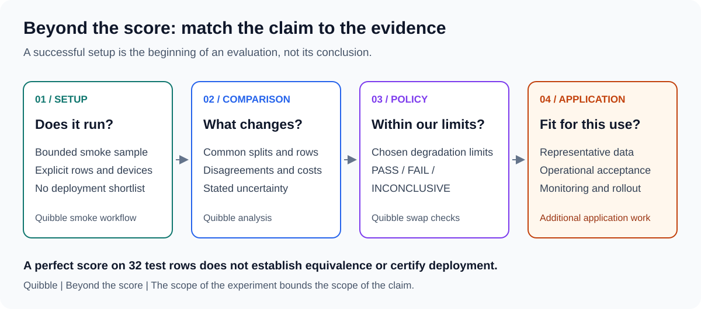

## Same Accuracy, Different Mistakes

*How do you choose a way to predict from tables when the score doesn't tell the whole story?*

*Predicting from Tables, Part 1.*

Suppose you have a table of historical invoices. Each row describes an invoice, the
information available when it was issued, and whether it was paid late. You want to
predict late payment for new invoices.

Two prediction methods each get 90% of a held-out set right. Is there any reason to
choose one over the other?

Yes, if they are wrong about different invoices. The same score can conceal different
mistakes, with different consequences.

I built **Quibble** to make those differences inspectable. It is a tool for comparing
ways to predict categories or numbers from tables. It runs selected methods on the same
evaluation rows, saves their predictions, and reports which answers change, how often
they are right, and what execution costs were measured.

The invoice scenario and 90% scores above illustrate the question; they are not results
from a Quibble experiment.

While exploring machine-learning and AI systems, I narrowed into this problem because
trying another prediction method is not the same as justifying its use. A replacement
decision needs answers to questions a single accuracy score cannot settle:

- Did it see the same training and test rows?
- Which predictions changed, not just which average improved?
- Did an important subgroup become worse?
- Did confidence become less reliable?
- What happened to latency, memory, or failure coverage?
- Is the evidence strong enough to decide?

Predicting a category, such as late or on time, is classification; predicting a number
is regression. Quibble's current methods include trees, AutoML, and pretrained
tabular predictors, also called tabular foundation models. They use prior learning across
tables for a new prediction task.

The point is not to produce another universal model ranking. It is to make a particular
comparison reviewable.

## Why not upload the CSV to ChatGPT?

You can. Asking ChatGPT to explain a table, predict outcomes, or write code to train a
predictor can all be useful. The file format does not separate these approaches.

What matters is what you ask it to do and how you check the result.

"Explain why payments are late in this table" is not the same test as "predict late
payment for these cases without seeing their outcomes." An explanation can sound
plausible without establishing predictive performance. Conversely, an LLM can be tested
as a predictor if its answers are evaluated against held-out outcomes.

There is another distinction: if ChatGPT runs Python to fit a tree-based predictor,
the result is a tool-assisted prediction workflow, not evidence that the language model
itself made those predictions unaided.

Quibble currently evaluates supported prediction libraries, not a general ChatGPT
workflow. A controlled LLM comparison is a future direction, not a completed experiment.
It would need explicit data access, prompts, tool permissions, output validation, and
cost accounting. [Part 2](02-making-prediction-comparisons-worth-trusting.md#what-a-fair-llm-comparison-would-require)
outlines that extension.

So the question is not "traditional ML or AI?" It is: **which approach produces useful
predictions under the conditions we actually need?**

## What makes a comparison useful?

A useful comparison connects a result to the decision it supports: which cases change,
whether the tradeoffs are acceptable, and what remains uncertain.

That is the standard I used for Quibble's reports. It also gives a reviewer a concrete
question to ask:

> Can we explain the decision from the experiment's evidence, or only from its final score?

## Accuracy can agree while behavior differs

Consider a thought experiment, not a result from Quibble's saved runs.

Two binary classifiers each score 90% accuracy on the same 100 rows. The first is wrong
on rows 1 through 10; the second is wrong on rows 11 through 20.

The score is unchanged, but their predicted classes differ on 20 rows.

That difference can matter even before either model is deployed. It tells us to inspect
which cases move, whether the changes are concentrated, and what changing those decisions
would cost in the application.

A headline score summarizes a task. It does not describe the full effect of a replacement.

Quibble therefore saves test predictions, target values, and original row positions. It
can identify disputed predictions, examine who was correct, and export the disputed rows
with diagnostic features.

This makes disagreement something a reviewer can investigate instead of a number to
mention and discard. The [analysis guide](../analysis.md) explains the definitions,
including how regression disagreements differ from classification disagreements.

## A real observation: four perfect scores, no winner

One local setup check made the distinction between an observation and a conclusion
particularly clear.

I ran HistGradientBoosting, LightGBM, Google TabFM, and NVIDIA KumoTabular on the bundled
Wine classification dataset. It was an intentionally bounded smoke check, not a full
benchmark campaign.

Each fit used 124 training rows and the same 32 held-out test rows:

| Prediction method | Effective device | Training rows | Evaluated test rows | Accuracy |
|---|---|---|---|---|
| HistGradientBoosting | CPU | 124 | 32 | 100% |
| LightGBM | CPU | 124 | 32 | 100% |
| TabFM | CUDA | 124 | 32 | 100% |
| KumoTabular | CUDA | 124 | 32 | 100% |

All six pairs of methods agreed on their predicted classes for those 32 rows.

That is 0 disagreements across 192 pair-row comparisons, but still only **32 distinct
test rows**. Pairing the same observations six ways does not create 192 independent
observations.

The defensible conclusion was that all four selected methods completed this setup check
and agreed on this sample. It did not establish that they were equivalent, that their
probabilities were identical, or that one was a better production choice.

It also mixed CPU and CUDA execution. Even if I had compared the measured runtime values,
that would not have isolated model differences from hardware differences.
This is a historical observation: current GPU-only sweeps exclude HistGB and this
LightGBM adapter rather than run those methods on CPU.

The [source and verification notes](../assets/blog/wine-smoke-evidence.json) and
[portable table](../assets/blog/wine-smoke-summary.csv) document this example. The observation
was checked against archived run records and prediction arrays, not inferred from a
screenshot. Wine's origin is documented by
[scikit-learn](https://scikit-learn.org/stable/modules/generated/sklearn.datasets.load_wine.html).

## Separate the stages of evidence

This became an important boundary in the user experience:

A smoke check asks whether a selected configuration runs on a small, controlled sample.
A full comparison evaluates the intended training splits. A swap assessment applies
defined limits to paired evidence. Application validation still has to establish
relevance to the deployment setting.

Those are different questions.

Quibble's smoke runs live in isolated output directories and carry an explicit label.
Their reports still interpret what happened: completed inference, sample sizes, measured
scores/resources, disagreements, and next steps. They do not issue deployment shortlists
or swap approval.

Withholding a ranking is useful when the experiment was not designed to support one.

## A replacement decision needs a policy, not a victory label

A candidate can improve a quality metric and still be unsuitable under an application's
latency or memory budget. It can maintain overall accuracy and change too many individual
decisions. It can also fail on cases the incumbent completed.

Quibble expresses a proposed replacement as a set of checks:

- Quality degradation on a selected metric.
- Prediction disagreement and, for classification, confident disagreements.
- Calibration change and the worst observed eligible diagnostic slice.
- Latency and process-memory ratios.
- Coverage relative to the incumbent's usable splits.

The limits are application choices. The bundled defaults are starting points, not
universal safety standards.

When an interval is available, a check passes if the whole interval is within the limit,
fails if it is entirely beyond it, and remains INCONCLUSIVE if it crosses the limit.
Checks without intervals use point values; missing bootstrap intervals also fall back
to point checks.

The overall verdict follows those evaluated checks. A PASS is not a production
certification, and a FAIL may reflect an operational limit rather than worse prediction
quality. Requested-fit completion is also visible separately in the participation table
and benchmark exit status.

The [swap guide](../swap.md) covers the exact rules and caveats.

## Uncertainty has to match the question

Repeated cross-validation can produce multiple predictions for the same original row.
Treating them all as independent evidence would overstate what was observed.

Quibble's bootstrap clusters those repeated predictions by original row. Backends are
compared using matched resamples.

That is a useful control, not a complete account of uncertainty. These intervals describe
test-row sampling variation conditional on the fitted predictions. They do not measure
the full variation from retraining on different training populations.

Similarly, overlapping marginal confidence intervals do not prove equivalence or decide
a paired difference. The policy question is whether the paired degradation is acceptable
under a meaningful limit.

These distinctions matter more than adding another decimal place to a leaderboard.

## Operational details are part of the result

The project also made me treat execution metadata as evaluation evidence.

An AUTO setting is a device-selection policy, not an experiment comparing CPU with GPU.
A saved prediction can be cached rather than freshly produced. A missing result can be a
refusal, an import problem, a timeout, or a worker failure.

Those states should not collapse into an empty cell.

Quibble records requested, resolved, and effective devices; labels mixed CPU/GPU reports;
and distinguishes participation, completed work, cached cells, failures, and predictions
actually used in the aligned analysis.

It also records model-level resource failures without silently retrying on CPU. Otherwise,
a sweep intended for one hardware configuration could quietly become a different experiment.

## What I chose not to claim

The report explains measured behavior. It does not expose a predictor's internal
reasoning. Two methods making similar predictions is an observation worth investigating,
not proof that they use the same internal algorithm.

This is not a broad empirical comparison showing that a particular foundation model
beats trees, or that trees are always preferable. The Wine observation is too small for
that claim, and the device mix would complicate resource comparisons.

The work is also not a new training algorithm. It uses established libraries and evaluation
ideas to build a documented, inspectable workflow around a decision that teams already face.

Some important capabilities remain outside the current implementation: temporal/grouped
evaluation, automated leakage detection, a complete configuration fingerprint, and an
automatic baseline-selection/abstention layer. The swap command's INCONCLUSIVE result
is not that future abstention feature.

Those boundaries are described in [limitations](../limitations.md) and the
[validation matrix](../index.md#trust-levels-what-has-actually-been-run).

## A next experiment: create a task we can inspect

The next step should not be to collect more perfect scores on familiar examples.
I want to ask what happens as a task becomes harder in a specific, controlled way.

The browser workflow starts with a request: create a fictional grocery-chain dataset
with a chosen number of rows and predictor fields, then compare ways to predict whether
inventory will cover demand during a delivery window.

The interesting part is not generating a table that looks like grocery data. It is
specifying what determines demand, what information is available when predicting it,
and what remains uncertain.

With the bounded generator, we can hold the task fixed while adding irrelevant
fields, reduce training examples, or increase outcome noise. Simple credible baselines
would help establish what the more complex methods contribute. Independently generated
tables would help show whether a finding survives beyond one sample.

The [localhost workbench](../experiment-workbench.md) now supports specification
review, deterministic generation, and comparison. Additional baseline methods remain
proposed work. Such experiments tell us about the chosen simulation, not establish
grocery forecasting accuracy. The simulation's assumptions must remain visible, and useful findings still
need representative real-data evaluation.

Fresh synthetic examples can reduce dependence on familiar benchmark rows. They do
not make the experiment unbiased or guarantee that the underlying task is unfamiliar
to every pretrained method.

That distinction matters when comparing predictors trained on many other tables.
Public benchmark rows may have appeared during pretraining; I cannot establish every
predictor's training history. Sampling new rows avoids relying only on those exact
examples, but similar rules and task structures may already be familiar. The recipe
itself can also favor a method. "Freshly generated" is a description of the data, not
a certificate that the test is uncontaminated.

The UI makes that reasoning visible: review the assumptions and sample, accept saved
data unchanged or save a new variant, then run a comparison and inspect the interpreted
report. It is an additional path through the same evaluation pipeline. Command-line
workflows remain available for automation and more extensive experiment designs.

That is the direction I find useful: make a testable question, preserve its assumptions,
and see whether the conclusion holds when the conditions change.

## The practical takeaway

Before accepting a replacement, ask for more than its score:

1. Comparable data and split assignments.
2. Predictions connected to original rows.
3. Visible participation and failures.
4. Measured costs with explicit hardware context.
5. A paired analysis with stated uncertainty.
6. Limits chosen for the application.
7. An explanation that stops where the evidence stops.

That is the problem I chose to work on: not simply running more models, but making the
decision between them easier to inspect.

Continue with **[Part 2: Making Prediction Comparisons Worth Trusting](02-making-prediction-comparisons-worth-trusting.md)** for
the architecture, source-identity controls, operational tradeoffs, and local-data workflow.
To try it first, start with [Getting started](../getting-started.md) or
[Testing your own data](../testing-your-data.md).
