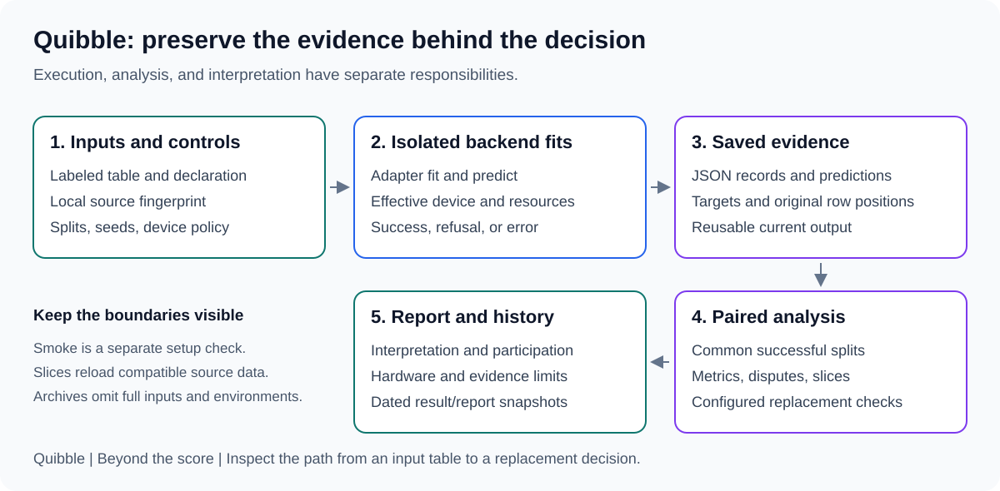

## Making Prediction Comparisons Worth Trusting

*Predicting from Tables, Part 2: engineering the evidence.*

A comparison report is only as useful as the chain of evidence behind it.

I built **Quibble**, a tool that compares ways to predict categories or numbers from
tables, to keep that chain inspectable: the evaluation rows, predicted answers,
execution outcomes, and checks used to assess a proposed change.

[Part 1, Same Accuracy, Different Mistakes](01-same-accuracy-different-mistakes.md),
explains the problem behind it. Here, I walk through the engineering decisions that
connect an experiment to a report a reviewer can question.

The task is to predict categories or numbers for cases whose outcomes are held back
for evaluation. Current methods include trees, AutoML, and pretrained tabular predictors.
An LLM could also attempt this task; a controlled comparison would be an extension, not
something this implementation has already measured.

The recurring design question was:

> What assumption could make this result misleading, and where should the workflow
> record, check, or expose it?

## Design around the evidence, not just the estimator

Quibble separates execution from analysis and reporting:



The central artifact is not merely the fitted estimator. It is the evaluation record:
what ran, with which settings and rows, what it predicted, how it performed, and whether
execution completed.

In the code, a *backend* is the adapter that connects a prediction library to the common
evaluation workflow. It is not a synonym for an LLM provider or a model-hosting service.

Each backend implements a narrow fit/predict contract. Classification produces class
probabilities; regression produces numeric predictions. Optional libraries are imported
when needed, so their absence does not prevent unrelated backends from loading.

That adapter boundary keeps library-specific behavior separate from the comparison
protocol. Adding another backend is useful only if its effective behavior is recorded
well enough to interpret the resulting experiment.

The [backend guide](../backends.md) describes the adapters and their constraints.

## 1. Make row identity explicit

Dataset, split scheme, assignment seed, and split ID determine which rows are held out.
Model seeds vary model randomness without changing the comparison's row assignments.

For each split, the output stores:

- Original test-row positions.
- True test targets.
- Backend prediction arrays.
- A JSON run record containing settings, measurements, and outcome.

Saving row identity makes disagreement exports possible. It also lets the workflow reject
attempts to overwrite shared test arrays with a different split assignment.

The intended comparison is between models on compatible evidence, not between whatever
two files happen to have similar names.

That does not mean every adapter has identical internal behavior. AutoGluon controls its
own preprocessing and internal model selection; its seed is not controlled by this harness.
Effective settings and documented adapter exceptions matter alongside shared outer splits.

## 2. Treat input identity as more than a filename

A file called `data.csv` can change while its name stays the same.

Without a source check, a later report could combine predictions from an earlier table
with diagnostic features from a new version. Changing a feature while preserving row
count and target values is enough to create that problem.

For local inputs, Quibble records a SHA-256 of the file and a fingerprint that combines
file content with the manifest declaration. The declaration includes target/task and
column rules.

Training and analysis check compatibility with successful saved records. Changed local
sources require restoring the original input or using a new experiment output root.
The guard also applies to swap and quick-comparison paths.

This identity is intentionally narrower than a complete experiment fingerprint. It does
not yet encode every library version, training setting, or environmental influence.
Unchanged filenames are insufficient, but a content hash is not a complete reproducibility
guarantee either.

The relevant implementation is in [dataset loading and validation](../../quibble/datasets.py);
the [regression tests](../../tests/test_local_datasets.py) include feature-only and
manifest changes.

## 3. Make execution outcomes first-class data

Sweeps use a worker process per fit. This gives each worker a separate process-memory
high-water mark and contains many fit-level failures.

The outcome record distinguishes unsupported tasks/sizes, ordinary execution errors,
resource failures, timeouts, worker exit, and missing results. Other cells can continue
after a model-level failure.

The scope of that resilience is explicit. Configuration, archive, or output-storage
failures can still stop the command.

The reporting layer distinguishes:

| State | Why it matters |
|---|---|
| Selected | A model was requested, not merely installed |
| Cached | Measurements were reused, not freshly generated |
| Incompatible | Saved settings do not match the requested comparison |
| Completed | The recorded fit did not error or refuse |
| Failed/refused/missing | Coverage is incomplete and needs explanation |
| Used in comparison | Predictions contributed to the common aligned analysis |

A model absent from a quality table should not become an unexplained disappearance.
Alignment can drop splits, and a backend with no usable predictions is excluded; failure
coverage remains visible separately.

For automation, `benchmark` returns a non-zero status when requested cells fail, refuse,
are missing, or are incompatible. That execution status is distinct from a swap policy's
PASS / FAIL / INCONCLUSIVE decision.

## 4. Record what the device policy actually did

`cpu`, `cuda`, and `auto` are deliberate policies.

CPU stays on CPU. CUDA requires availability. AUTO resolves once per sweep and is pinned
for its workers.

CUDA sweeps visibly exclude methods that cannot meet GPU-only model execution:
HistGB/Weak have no CUDA implementation, this LightGBM adapter uses CPU, and AutoGluon
can combine CPU components despite a GPU resource budget. CPU runs keep all selected
methods. Data preparation, metrics, and reporting still use CPU.
The report therefore records the requested policy, resolved sweep device, attempted
backend device, and completed effective device where available.

The [Full-run workflow](../running-benchmarks.md#what-full-does-and-what-the-results-establish)
connects split assignments, training-only preprocessing, fitting, held-out prediction,
and analysis to the claims that the evidence can support. Fast `fit()` is not proof of
cheap inference, particularly for pretrained predictors that condition on training rows.

The workflow does not silently recover from an out-of-memory fit by training it on CPU.
That would change the experiment while concealing an operational constraint.

The [device/resource tests](../../tests/test_device_resources.py) exercise pinning, resource
failures, worker errors, and mixed-device labeling. Those tests are not a substitute for
running every model/task combination on real hardware; the
[validation matrix](../index.md#trust-levels-what-has-actually-been-run) separates
the two kinds of evidence.

## 5. Separate measurement from service-level claims

Quibble measures fit time, batch prediction cost per row, single-row latency percentiles,
process peak memory, and PyTorch allocation peaks when applicable.

Those numbers need definitions:

- Fit time surrounds the adapter's fit call. For a foundation adapter, that can include
  model loading and initialization, not just training or conditioning on the table.
- Process peak RSS includes process/library overhead. It is not the serialized model size.
- PyTorch allocation peaks are not total GPU memory for every library.
- Parallel jobs introduce contention. `--jobs 1` is the appropriate starting point for
  resource measurements intended for publication.
- One local run is not a service-level latency guarantee, cloud-cost estimate, or controlled
  warm-versus-cold performance study.

The report can provide conditional resource shortlists, but only from valid measurements
and with the observed quality alongside them. It does not turn the smallest timing into
an unconditional deployment recommendation.

## 6. Keep analysis downstream of saved predictions

Quality summaries and paired comparisons use common successful splits at the selected
model seed. Repeated predictions for one row remain clustered during bootstrap resampling.

This avoids treating repeated-CV appearances as independent test observations. It does not
capture full retraining variation. Marginal interval overlap is also not a substitute for
a paired degradation calculation.

Calibration and diagnostic slices provide additional views. Slice construction uses
the loaded dataset, and the worst-slice check is exploratory and not corrected for
multiple comparisons. These are investigation aids, not automatic causal or fairness
certifications.

Swap latency/memory checks average usable runs for each backend separately; with incomplete
coverage, those populations can differ from the aligned quality pool. This is another
reason to inspect participation instead of relying on the final verdict alone.

The [analysis](../analysis.md) and [swap](../swap.md) references contain the full rules.

## 7. Make history useful without pretending it contains everything

Download caches, current results, retained fits, and historical evidence are different things.

| Location | Role |
|---|---|
| `.cache` | Downloaded checkpoints, datasets, and supported library/compiler caches |
| `data/<name>` | A user-provided table and its declaration |
| `results/web/<job-id>` | A browser-launched job, its execution log, and isolated benchmark/report output |
| `results/<dataset>` | Current records, predictions, and analysis |
| `results/smoke/<id>` | Isolated bounded setup-check evidence |
| `results/artifacts` | Optional supported fitted models |
| `results/runs/<date>/<id>` | Dated copies of generated result/report evidence |

Existing cells are reused, including errors, unless explicitly retried. Training and report
generation preserve dated evidence. Retained fits use unique directories and are linked
from historical reports rather than copied into every snapshot.

Snapshots do not include the full original feature table, downloaded weights, or the
virtual environment. Regenerating a report does not retrain models, but analysis reloads
source data for row traits and slices. The original source must remain available and compatible.

That distinction prevents "we have a report archive" from becoming "we can reproduce
everything without the inputs."

## Try the workflow on your own data

Here is the compact classification path. The
[complete local-data guide](../testing-your-data.md) covers setup, file requirements,
a runnable synthetic example, missing values, Parquet, regression, outputs, and privacy.

For interactive use, `python -m quibble web --open` starts the localhost workbench.
Choose an existing dataset, inspect its saved rows and metadata, and use it unchanged.
Or review a generation specification and save a new named variant.
**Save and continue** opens configuration with the saved variant; the adjacent
**Discard changes and continue** uses the unchanged original. Neither starts a run.
An unchanged saved recipe needs no generation, and a completed preview stays disabled
until the recipe changes. The workflow is **Choose data -> Configure & run -> Results**,
with **Past experiments** separate from those steps. The browser also adds
field/method help, a running indicator, sanitized report formatting, and an experiment
link for returning later. Closing the tab does not stop work while the server remains
running. Completed reports persist on disk.

This is an additional interface, not a replacement for the commands below. Browser jobs
invoke the existing benchmark runner; scripting, additional model seeds, and broader
split configurations remain CLI workflows. A more convenient interface does not change
what a smoke test or confidence interval can establish.

Create a named folder:

```text
data/
  payments/
    data.csv
    dataset.json
```

The table must contain the declared columns and labeled observations. For this example,
the declaration would be:

```json
{
  "file": "data.csv",
  "target": "paid_late",
  "task": "classification",
  "drop_columns": ["customer_id"],
  "categorical_columns": ["region"]
}
```

The target is removed from features. Declared excluded columns are dropped before the
split. For classification, labels are encoded and their column order is recorded.
Temporal/grouped evaluation and automatic leakage detection are not implemented, so
choosing a suitable table and evaluation design remains the user's responsibility.

After following the [environment setup](../getting-started.md#install),
validate and start with a bounded tree-model smoke check:

```powershell
python -m quibble datasets --verify --names payments
python -m quibble benchmark --datasets payments --backends histgb,lightgbm --device cpu --jobs 1 --smoke --out results_payments
```

Read the smoke interpretation, then run the full training splits:

```powershell
python -m quibble benchmark --datasets payments --backends histgb,lightgbm --device cpu --jobs 1 --cv 3x2 --model-seeds 0 --out results_payments
```

The full report is `results_payments/report/report.md`; smoke outputs stay under their
own `smoke/<id>` roots.

For replacement limits, start from the
[packaged defaults](../../quibble/swap_thresholds.json), review every applicable default,
and set values justified by the application. Writing the following illustration to
`limits.json` would override only the listed keys:

```json
{
  "primary": "log_loss",
  "max_quality_drop": 0.02,
  "max_disagreement": 0.05,
  "max_latency_ratio": 2.0
}
```

Those values are illustrative policy inputs, not recommended universal tolerances.
Other limits remain at their defaults.

```powershell
python -m quibble swap --dataset payments --incumbent histgb --candidate lightgbm --out results_payments --thresholds limits.json
```

The important output is the explanation of which limits passed, failed, or remained
uncertain, alongside the paired evidence.

## Tests should target ways the evidence could mislead

I organized regression coverage around the workflow's assumptions, not only successful fits:

- Do split identities stay fixed when the model seed changes?
- Does the sign of degradation remain correct for higher- and lower-is-better metrics?
- Do repeated predictions share their bootstrap row weight?
- Are feature-only source changes rejected against saved predictions?
- Can a failed worker leave an older success looking current?
- Does a smoke report explain its observations without approving a swap?
- Do archived figures and evidence links remain resolvable?

Real CSV classification and Parquet regression CLI tests complement the unit contracts.
Mocked adapter/device cases are useful for failure coverage, but they do not establish
real GPU support or large-data capacity.

See the [development guide](../development.md) for the suite structure.

## From a scenario to a controlled experiment

The localhost workbench lets a user describe a task, choose a row count and predictor
count, review its specification, and generate a labeled table for comparison.

There are two reasons to do this: control the task's difficulty and avoid relying only
on familiar benchmark rows. A pretrained tabular predictor may have encountered public
evaluation tables before. Fresh sampling reduces direct reuse of those examples, but
does not prove an unseen task: related rules can be familiar, scenario drafting can
introduce familiar assumptions, and the chosen generator can favor particular methods.
This is a way to make those assumptions inspectable, not a contamination detector.

For example: a fictional grocery chain wants to predict whether inventory will cover
demand during the next delivery window. Before generating rows, the workflow should
confirm what one row represents, which inputs exist at decision time, and how the
outcome is produced. "18 predictor fields" should mean exactly that, with the target
and excluded metadata counted separately.

I separated three responsibilities:

1. A scenario specification describes the fields, units, relationships, and task.
2. Reviewed generation code samples inputs and outcomes using versioned rules and a seed.
3. The existing evaluation workflow compares predictions against held-out outcomes.

An optional user-configured language-model service drafts the specification, with explicit
consent. OpenAI-compatible endpoints can use provider keys, Azure deployments can use
Microsoft Entra ID, and local services can operate without authentication. It does not become an
unreviewed source of executable code, or a mechanism for inventing both answers and the
argument that those answers are correct.

The generator writes a CSV table and the existing `dataset.json`. A separate
`generation.json` preserves the reviewed specification, version, seed, file hash, and
planning provenance. Source fingerprints include this metadata, and reports label the
experiment synthetic. Latent/noiseless outcomes never become predictor columns.

The first version uses independent rows. Repeated store-item histories would need
time/group-aware splits before we could claim to evaluate the corresponding real
workflow. Current random splits do not supply that protection.

Before fitting, validate the exact size, schema, target values, and split feasibility.
Then run the normal validation, smoke, and full-comparison stages. No special scoring
path should make generated data look more successful.

Useful experiments would vary one condition at a time: training size, irrelevant fields,
missingness, or outcome noise. Repeat across generation seeds and task structures,
include simple baselines and no-signal controls, and keep development variants separate
from final evaluation.

Automated checks cover exact shape, reproducibility, review gates, source identity,
HTTP boundaries, and real generated-data comparisons. Provider/auth contracts include mocked
validation-guided correction; a live HTTP response alone does not establish a valid draft.
A generated grocery-themed
dataset provides a known test environment, not evidence that it matches real operations.
The [workbench guide](../experiment-workbench.md) records supported mathematics,
limits, setup, and the distinction between local execution and optional cloud planning.

## What a fair LLM comparison would require

Uploading a CSV to ChatGPT is a reasonable starting point for analysis. To compare it
with the current predictors, I would first define which workflow was being tested:

- Direct LLM predictions from permitted examples and table descriptions.
- An LLM using tools to train and run a predictor.

Those should be reported as separate workflows. Otherwise a result attributed to an
LLM may actually come from a statistical method it chose to invoke.

The target task, evaluation rows, and information available at prediction time must be
defined before running either workflow. Test labels must not enter prompts, tool inputs,
example selection, or iterative prompt tuning. Training-data access and compute/token
budgets must be documented; equal test rows alone do not make those resources equal.

For a reproducible record, I would preserve the prompt, table serialization, permitted
tools, available provider/version identifiers, sampling settings, and retry policy.
Missing answers, malformed outputs, and refusals must count in coverage rather than
disappear from the score. A fixed per-row output schema would be required.

The existing analysis contract would also need work. A generated sentence such as
"90% confident" is not automatically a calibrated class probability. A comparison should
use metrics supported by its actual outputs and explicitly mark unavailable probability
checks; it should not manufacture probability arrays to satisfy the current interface.

Operational costs need their own treatment. For a hosted service, end-to-end request
latency, tokens, and API cost are relevant. The memory of the local API client does not
measure the remote predictor's memory. Tool-assisted workflows should account for tool
execution as well.

Finally, there are data-handling and contamination questions. Sending rows to a provider
requires permission and appropriate handling. Public benchmark examples may already be
in pretraining, even when labels are omitted from the prompt. That uncertainty should
be disclosed, not treated as solved by a random split.

This is proposed evaluation work, not an implemented adapter or a benchmark result.
It extends the same central question: can a reviewer see what was tested and what the
comparison actually establishes? The [project plan](../project-plan.md) records
the direction without claiming a completed comparison.

## Boundaries worth keeping visible

This workflow still needs a broader verified dataset campaign, more real model/platform
coverage, and temporal/grouped evaluation support. Local source fingerprints are not yet
complete configuration fingerprints. A future baseline/abstention layer is a proposal,
not the current CLI's behavior.

There is a data-handling boundary too: disagreement exports can contain original feature
values. Git ignore rules are not access control, and custom output roots need their own
protection. Review records, tables, retained models, and reports before sharing them.

The [limitations](../limitations.md) and
[project plan](../project-plan.md) make these boundaries part of the contract.

## What the engineering work contributes

The outcome I wanted was not a larger collection of adapters. It was a shorter distance
between a proposed change and the evidence needed to review it.

That required data contracts, explicit state, source identity, operational failure handling,
statistical care, and an interpretation layer that does not outrun the experiment.

For anyone building an evaluation system, the transferable question is the same:

**What would a reviewer need to reconstruct this decision, and have we preserved it?**

Start with [Getting started](../getting-started.md), follow the
[local-data walkthrough](../testing-your-data.md), or return to
[Part 1](01-same-accuracy-different-mistakes.md) for the decision framework.
